<!-- ======================= BANNER ======================= -->
<p align="center">
  
</p>

<p align="center">
  
</p>

<p align="center">
  
  
  
  
</p>


## `STAGE 01` ▸ 🎮 FICHA DEL JUGADOR

```ini
[ JUGADOR ]
nick        = Panqueca
clase       = Aprendiz de Análisis y Desarrollo de Software
gremio      = SENA // Colombia 🇨🇴

[ INVENTARIO ]
backend     = Laravel · PHP · C# · .NET
mobile      = Flutter · Dart
frontend    = HTML · CSS · JavaScript
datos       = Python · Pandas · MySQL · Excel · Power BI

[ HABILIDADES ESPECIALES ]
combo_1     = Power Query → Power Pivot → Power BI
combo_2     = Python + Pandas → limpieza y análisis de datos

[ PROGRESO ]
nivel       = subiendo ▓▓▓▓▓▓▓░░░  70%
vidas       = ♥ ♥ ♥
```

> 🕹️ **Partida actual:** construyendo APIs, apps y tableros de datos.<br/>
> 💬 **Pregúntame sobre:** PHP · Laravel · C# · Python · Power BI


## `STAGE 02` ▸ ⚔️ ARSENAL

<p align="center"><b>🗡️ ARMAS PRINCIPALES</b></p>
<p align="center">
  
  
  
  
  
</p>

<p align="center"><b>📱 MÓVIL Y WEB</b></p>
<p align="center">
  
  
  
  
  
</p>

<p align="center"><b>📊 MAGIA DE DATOS</b></p>
<p align="center">
  
  
  
  
  
  
</p>

<p align="center"><b>🔧 EQUIPO</b></p>
<p align="center">
  
  
  
</p>


## `STAGE 03` ▸ 🏆 NIVELES SUPERADOS

| 🔻 NIVEL | 📜 MISIÓN | 🧪 STACK |
|---|---|---|
| 📇 [**Contacts-API**](https://github.com/CamiloRC317/Contacts-API) | API REST para gestionar contactos |   |
| ✈️ [**ProyectoAmonic**](https://github.com/CamiloRC317/ProyectoAmonic) | Aplicación de escritorio del proyecto AMONIC |  |
| 🏫 [**Colegio.py**](https://github.com/CamiloRC317/Colegio.py) | Listas de colegio con 3 roles de usuario |  |
| ⚡ [**Clases-de-eventos-JS**](https://github.com/CamiloRC317/Clases-de-eventos-JS) | Práctica de eventos en JavaScript |  |
| 🗄️ [**Base-de-Datos-evaluacion**](https://github.com/CamiloRC317/Base-de-Datos-evaluacion) | Evaluación de diseño de bases de datos |  |
| 🛫 [**Taller LATAM**](https://github.com/CamiloRC317/Redondo_Juan_Taller_LATAM) | Modelado de datos para un sistema de vuelos |  |

<p align="center">
  <a href="https://github.com/CamiloRC317?tab=repositories">
    
  </a>
</p>


## `STAGE 04` ▸ 📈 MARCADOR

<p align="center">
  
  
</p>

<p align="center">
  
</p>

<p align="center">
  
</p>

<p align="center">
  
</p>


## `STAGE 05` ▸ 📡 MULTIJUGADOR

<p align="center">
  <a href="https://github.com/CamiloRC317"></a>
</p>

<p align="center">
  
</p>
